<!-- ---- 헤더 배너 (물결만, 글자 없음) ---- -->

  

<!-- ---- 제목 (font= 뒤의 이름만 바꾸면 폰트 변경) ---- -->

  

<!-- ---- 타이핑 애니메이션 ---- -->

  

  
  

 

<!-- ---- 자기소개 ---- -->
## About Me

- **전남대학교** 통계학 · 데이터사이언스 복수전공
- SK AX **SKALA** AI 서비스 개발 부트캠프 4기 (2026.07 ~, 광주 캠퍼스)
- 관심 분야: **핀테크**, **LLM / AI 서비스 개발**
- 요즘 공부 중: RAG · LangGraph Agent, LLM 파인튜닝, MSA · Kubernetes
- 목표: 통계적 사고와 AI 기술을 엮어 **실제로 쓰이는 서비스**를 만드는 개발자

 

<!-- ---- 기술 스택 ---- -->
## Tech Stack

<!-- ---- lowlighter/metrics 카드 (metrics.yml 워크플로가 자동 생성) ---- -->

  
  

 

<!-- ---- 프로젝트 ---- -->
## Projects

| 프로젝트 | 설명 | 키워드 |
|:--|:--|:--|
| **Docktimize** | 울산 터미널 선박 체선료 최적화 Agent (SKALA 파이널, 6인 팀) | `AI Agent` `최적화` |
| **CoreWatch** | MME 데이터 기반 통신 코어 이상 탐지 서비스 | `Anomaly Detection` `B2B` |
| **저작권 판례 RAG** | Baseline RAG 성능 개선 챌린지 | `Advanced RAG` |
| **LLM 파인튜닝** | Qwen2.5-1.5B LoRA/SFT — Base vs Fine-tuned vs RAG 비교 평가 | `LoRA` `PyTorch` |
| **신약 후보물질 독성 예측** | 머신러닝 기반 이진 분류 | `scikit-learn` |

 

<!-- ---- 활동 ---- -->
## Activities

- **2026.07 ~** &nbsp; SK AX SKALA AI 서비스 개발 부트캠프 4기
- **2025.07 ~ 08** &nbsp; SK AI Dream Camp 2025 고급반 수료
- **2024.05 ~ 08** &nbsp; CJ 리모트 인턴십 프로그램
- **2024.03 ~ 2025.02** &nbsp; 통계학과 학습 동아리 *sigma* 회장
- **2023.07** &nbsp; KSIAM-NIMS Math Challenge

 

<!-- ---- 잔디 먹는 뱀 애니메이션 ---- -->
## Contribution Snake

  <picture>
    <source media="(prefers-color-scheme: dark)" srcset="https://raw.githubusercontent.com/develop-jw/develop-jw/output/github-snake-dark.svg" />
    
  </picture>

 

<!-- ---- 연락처 ---- -->
## Connect with Me

  
  

<!-- ---- 푸터 배너 ---- -->

  

